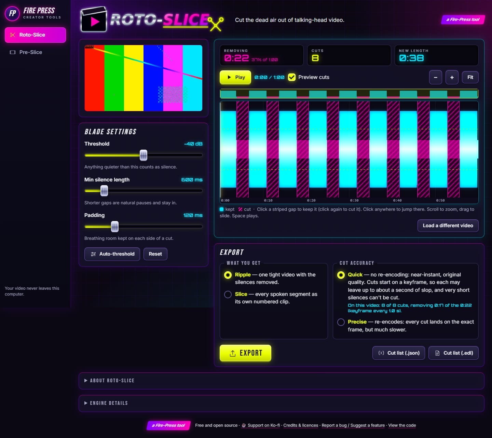

# Roto-Slice

**Cut the dead air out of talking-head video.** Free and open source, from [Fire-Press](https://fire-press.netlify.app).

**Live:** https://roto-slice.pages.dev



Drop in a video. Roto-Slice finds the silent parts and cuts them, so you get tight jump cuts without
the timeline work. Get one tight video, or every spoken bit as its own numbered clip. Pre-Slice mode
splits long videos into pieces, and you can also export a cut list (JSON / EDL) for your editor.

**It runs in your browser. Nothing is uploaded.** Your video never leaves your computer. There is no
account and no server. The ffmpeg engine runs as WebAssembly in your browser. Its one big file is
loaded from jsDelivr (version pinned and checked against a SHA-384 hash before use).

## Run it on your computer

You need [Node.js](https://nodejs.org) 22 or newer.

```
npm install
npm run dev
```

Then open http://localhost:5183. Other commands: `npm test` (unit tests), `npm run build`
(production build into `dist/`), `npm run serve:dist` (serves `dist/` with the real security headers
on port 5191). The app needs internet access the first time, to fetch the ffmpeg engine file from jsDelivr.

## Report a bug or suggest a feature

[Open an issue](https://github.com/robbiefromramona-press/roto-slice/issues/new/choose). Please do not
attach private video; describe what happened and your browser instead. See [CONTRIBUTING.md](CONTRIBUTING.md).

## How it is built

Vite + plain JavaScript + ffmpeg.wasm. `scripts/copy-core.mjs` copies the (patched) ffmpeg core scripts
into `public/ffmpeg/` at build time; the patches add fast reads and write-to-disk output for big files.
Hosting is Cloudflare Pages, which refuses files over 25 MiB, which is why the ~31 MB `.wasm` files come
from jsDelivr. `public/_headers` holds the security headers, including cross-origin isolation (COOP and
COEP `require-corp`) for the fast multi-threaded engine. The brand files in `public/brand/` come from the
Fire-Press asset pack via `scripts/make-brand.mjs` (run once; the pack itself is not in this repo).

## Licenses

Roto-Slice is made of three kinds of material, with different licences:

| What | Licence |
|---|---|
| **Roto-Slice's own code** (everything in `src/`, `scripts/`, `tests/`, the HTML and CSS) | [MIT](LICENSE) (c) Fire-Press / Robbie |
| **The FFmpeg engine** the app downloads and runs (`@ffmpeg/core`, `@ffmpeg/core-mt` 0.12.10, built from FFmpeg 5.1.4 with `--enable-gpl`, x264 and x265) | **GPL-2.0-or-later**. Text: [public/licenses/GPL-2.0.txt](public/licenses/GPL-2.0.txt) |
| **Logos, icons and artwork** in `public/brand/` | (c) Fire-Press, **all rights reserved**. Not MIT. See [public/brand/COPYRIGHT.txt](public/brand/COPYRIGHT.txt) |

In plain terms: the app's own code is MIT, but the FFmpeg engine bundled with it is GPL. The two are
separate programs: the MIT code loads FFmpeg as a separate WebAssembly module and talks to it through
a message interface. You can reuse Roto-Slice's code under MIT. If you copy, host or redistribute the
FFmpeg engine (including the patched `ffmpeg-core.js` that `scripts/copy-core.mjs` produces), you must
follow the GPL for that part: keep the licence text with it and make its source available. The site's
[/credits](https://roto-slice.pages.dev/credits) page lists every library, font and asset with its
licence and links to the FFmpeg source. Fonts (Bebas Neue, Inter, Orbitron) are SIL OFL 1.1.

This is a practical summary, not legal advice.
